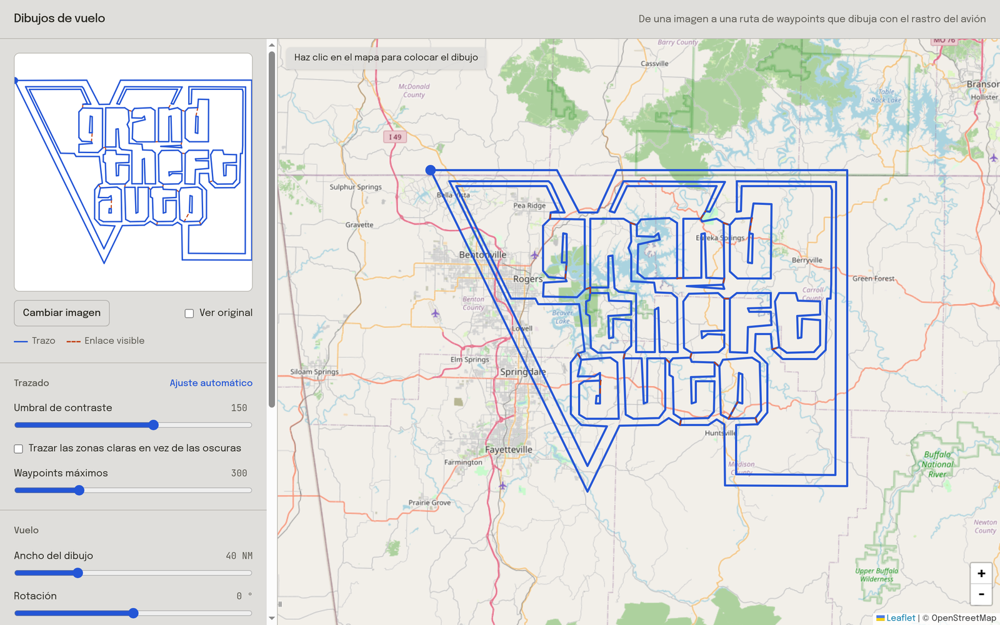
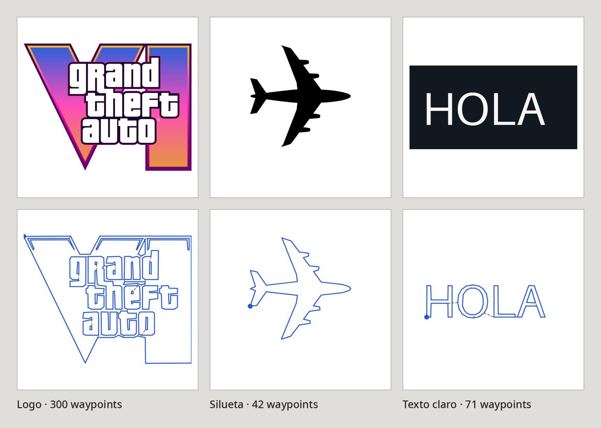

# imagetoflight

Convierte una imagen en una ruta de vuelo que, al volarla, dibuja la imagen con el rastro GPS del avión.

Sube un logo o una silueta, colócala en el mapa y exporta los waypoints en GPX, KML o CSV. Es el mismo tipo de dibujo que hizo el Cessna N1810R sobre Arkansas con el logo de GTA VI.



<p align="center">
  
</p>

## Ejemplos

Arriba, la imagen original. Abajo, la ruta que se genera: en azul lo que dibuja el avión, en naranja discontinuo los enlaces entre figuras.



## Cómo funciona

1. **Contornos.** La imagen se pasa a gris y se separa en tinta y fondo con un umbral de contraste (método de Otsu). Se detecta sola si la tinta es oscura sobre claro o al revés. Después se sacan los contornos con marching squares.
2. **Simplificación que se puede volar.** Los contornos se simplifican con Ramer–Douglas–Peucker hasta caber en el máximo de waypoints. El detalle más fino que se conserva es medio radio de viraje a la velocidad elegida, y las figuras demasiado pequeñas para volarlas se descartan antes que deformar las grandes.
3. **Un solo trazo.** Las figuras se unen con un árbol de expansión mínima: el avión sale por el enlace más corto, dibuja la figura y vuelve por el mismo enlace. Así las líneas sobrantes del rastro son las mínimas posibles y ningún contorno se vuela dos veces.
4. **Colocación.** Haces clic en el mapa para centrar el dibujo y eliges el ancho en millas náuticas, la rotación y la velocidad. La app calcula la distancia, el tiempo de vuelo y cuántas millas de enlaces quedarán visibles.

## Formatos de exportación

| Formato | Para qué |
|---|---|
| **GPX** | Ruta con waypoints `D001`, `D002`… para ForeFlight, Garmin Pilot, SkyDemon y similares |
| **KML** | Línea continua para Google Earth o como capa de mapa en una EFB |
| **CSV** | `name,lat,lon`, por si quieres procesarlo tú |

Muchos equipos de aviónica limitan un plan de vuelo a unos 100 waypoints. Para seguir un dibujo detallado suele ser más práctico cargar el KML como capa del mapa y volarlo a ojo, y reservar el GPX para equipos que admitan rutas largas.

## Consejos

- Funcionan mejor los logos, siluetas y textos con buen contraste. Con fotos hay que ajustar el umbral a mano.
- Unos 300 waypoints bastan para que se lea un logo con texto. Por debajo de 200 las letras empiezan a perderse.
- Cuanto más grande el dibujo, más detalle cabe. Pero la distancia crece igual de rápido: el logo de GTA VI a 40 NM de ancho son unas 780 NM, unas 6,5 horas a 120 kt.

## Desarrollo

Necesitas Node 22 o superior y pnpm.

```bash
pnpm install
pnpm dev       # http://localhost:5173
pnpm build     # tipos + build de producción en dist/
pnpm lint
```

Está hecho con React, Vite, Tailwind, [Leaflet](https://leafletjs.com) y [d3-contour](https://github.com/d3/d3-contour). Todo se procesa en el navegador: la imagen no se sube a ningún servidor.

## Aviso

Es una herramienta de planificación, no de navegación. Antes de volar cualquier ruta, comprueba el espacio aéreo, el terreno, los NOTAM y el combustible.

El mapa es de © colaboradores de [OpenStreetMap](https://www.openstreetmap.org/copyright). El logo de Grand Theft Auto VI es una marca de Rockstar Games y aparece aquí solo como ejemplo.
